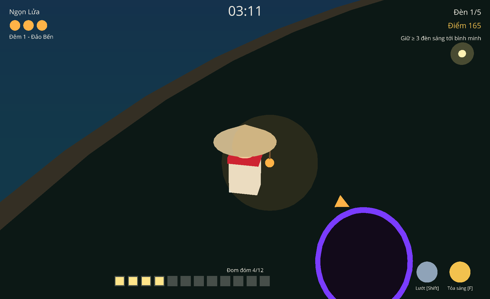
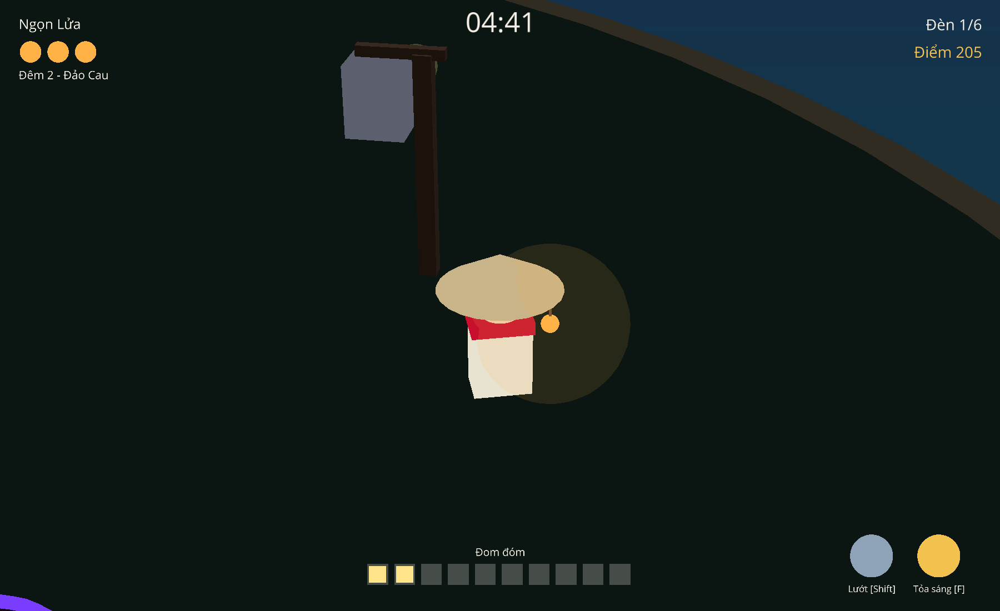

# Đảo Đèn Lồng (v1.0.0)

> **Video demo:** _[đính kèm Release v1.0.0](../../releases/tag/v1.0.0)_ (`demo.mp4`)
> Lab Day 12, AI SDLC · Trần Quốc Tuấn · 03561 · Tài liệu gốc của lab: [docs/lab/](docs/lab/README.md)

Game 3D góc nhìn thứ ba qua 3 Đêm. Mây, người giữ đèn nhỏ tuổi đội nón lá, gom đom đóm để thắp và **giữ** các Đèn Lồng Lớn cháy tới bình minh trên Đảo Bến, Đảo Cau và Đảo Chuông. Trên đường đi phải né Bóng Mực hút dầu và Gió Lạc cướp đom đóm.




## Yêu cầu hệ thống
- macOS hoặc Linux, Python ≥ 3.9 (đã thử trên macOS 26 với Python 3.11, Apple M2 Pro).
- GPU hỗ trợ OpenGL 3.2 trở lên (Panda3D). Cần khoảng 200 MB RAM khi chơi.
- Chế độ headless, test và soak chỉ cần Python thuần, không cần GPU hay Ursina.

## Cài đặt và chạy (3 lệnh)

```bash
git clone <repo> && cd <repo>
python3 -m pip install -r requirements.txt   # Ursina 7 (kéo theo Panda3D)
python3 play.py                              # menu → Đêm 1 → 2 → 3
```

Bản phát hành [v1.0.0](../../releases/tag/v1.0.0) có `DaoDenLong-v1.0.0-source.zip` kèm `run.sh` (tự tạo venv, cài đặt và chạy). Nếu đã build được, có thêm bản macOS arm64 dựng bằng PyInstaller.

## Điều khiển (đổi được trong Cài đặt → Đổi phím)

| Mặc định | Hành động |
|---|---|
| W A S D | Di chuyển theo hướng camera |
| Chuột / ← → | Xoay camera |
| Space | Nhảy |
| Shift | Lướt |
| E | Nạp đom đóm (thắp đèn) hoặc châm dầu |
| F / click trái | Tỏa Sáng (tốn 3 đom đóm) |
| P hoặc Esc | Tạm dừng |

Cài đặt (được lưu ở `~/.dao_den_long_settings.json`) gồm: âm lượng, độ nhạy chuột, bảng màu dễ phân biệt, giảm chuyển động, chữ lớn ×1.25, đổi phím.

## Luật và điểm (Ticket-03/04)
- Mỗi đèn cần 10 đom đóm để thắp lần đầu, hoặc 5 để thắp lại. Đèn đang sáng mất 1 dầu mỗi giây (tối đa 100); bấm E ở đèn đang sáng để châm thêm 10 dầu cho mỗi đom đóm. Đèn hết dầu thì tắt.
- Khi dầu dưới 30, đèn mất vùng an toàn 6 m, và Bóng Mực sẽ tới hút thêm 5 dầu mỗi giây.
- **Thắng** khi còn sống lúc bình minh (240 / 270 / 300 s) và có ít nhất 3/5, 4/6 hoặc 5/7 đèn đang sáng. **Thua** khi hết Ngọn Lửa, hoặc thiếu đèn lúc bình minh.
- Sức chứa đom đóm = 10 + 2 × số lần thắp thành công (tối đa 20).
- Điểm: +5 mỗi đom đóm nạp, +100 khi thắp lần đầu, +40 khi thắp lại, +5 mỗi Bóng Mực trúng Tỏa Sáng (+15 nếu nó đang hút dầu). Lúc bình minh, nếu thắng: mỗi đèn sáng được 50 + floor(dầu), mỗi Ngọn Lửa còn lại được 50.
- Bảng xếp hạng top 10 được lưu ở `~/.dao_den_long_leaderboard.json` và xem được từ menu.

## Test, headless, bench, soak

```bash
python3 -m unittest discover -s tests                     # 70 test (sim, CLI, leaderboard, bench scene, soak)
bash scripts/verify.sh phase-4                            # mọi kiểm chứng + báo cáo docs/proof/phase-4/REPORT.md
python3 headless.py --seed 1 --night 1 --ticks 600 --out out.jsonl [--scenario s.json] [--inputs i.json]
python3 play.py --bench-mode --seed 42 --duration 30 --out bench.json   # cảnh chuẩn 1280×720, vsync tắt
python3 soak.py --seed 7 --nights 10 --out soak.json
python3 play.py --export-leaderboard out.json
```

Kết quả tự đo (Apple M2 Pro, macOS 26): [bench.json](bench.json) ghi avg **115 FPS**, p1-low **60 FPS**, p95 9.9 ms, load 0.84 s, đỉnh RSS 188 MB. [soak.json](soak.json) ghi 10 Đêm, **0 crash**, RSS 17.3 → 17.3 MB. Vsync tắt được (`Ursina(vsync=False)`).

## Kiến trúc

```
lantern_island/sim.py          lõi logic tất định (stdlib); thứ tự tick theo Ticket-02/03; Game(bench=True) cho benchmark
lantern_island/maps.py         bản đồ chuẩn 3 Đêm
lantern_island/bench_scene.py  cảnh benchmark chuẩn (seed 42)
lantern_island/leaderboard.py  bảng xếp hạng (top 10, ghi file atomic)
headless.py / soak.py          CLI của contract
play.py                        Ursina: menu, HUD, cài đặt, đổi phím, phụ đề, âm thanh, bench, xuất bảng xếp hạng
```

## Bằng chứng, ghi chép, harness
- Truy vết yêu cầu → bằng chứng: [Phase 1](docs/proof/phase-1/TRACE.md) · [Phase 2](docs/proof/phase-2/TRACE.md) · [Phase 3](docs/proof/phase-3/TRACE.md) · [Phase 4](docs/proof/phase-4/TRACE.md)
- Spec và giả định: `docs/notes/phase-N-spec.md` · ADR: [0001](docs/adr/0001-lantern-fuel-and-dawn-win.md) · [CHANGELOG](CHANGELOG.md) · [Retro](docs/notes/retro.md) · [Nhật ký AI](docs/notes/ai-log.md)
- Harness AI:
  - [AGENTS.md](AGENTS.md) (CLAUDE.md trỏ tới file này)
  - Stop hook chặn kết thúc khi test đỏ: [.claude/settings.json](.claude/settings.json)
  - Skill [verify](.claude/skills/verify/SKILL.md)
  - CI [.github/workflows/ci.yml](.github/workflows/ci.yml)

## Sáng tạo của tôi

Mọi phần thêm đều nằm trong `play.py`, nên output headless không đổi. Cảnh bench và soak không dùng các phần này:
- **Lời Ông Đăng** riêng cho từng Đêm ở màn giới thiệu.
- **Vùng an toàn hiển thị:** vòng sáng 6 m, chỉ hiện khi đèn còn ≥ 30 dầu.
- **Phản hồi trạng thái:** Mây nhấp nháy khi bất tử, quầng đèn nhỏ lớn dần theo số đom đóm, Bóng Mực phồng dần khi đang `spawning`, đom đóm rơi nhấp nháy trước khi tan.
- **Âm thanh tự tổng hợp:** nhạc nền ngũ cung và 13 hiệu ứng (`scripts/gen_sfx.py`).

Bằng chứng phần cũ vẫn đúng: `scripts/verify.sh` chạy không cần Ursina và tất cả mục đều PASS ([REPORT](docs/proof/phase-4/REPORT.md)).

## Giấy phép
Mã nguồn: [LICENSE](LICENSE) (MIT). Nguồn asset, âm thanh và công cụ AI: [CREDITS.md](CREDITS.md).
